# MadaStore Sales Analytics

**Un projet guidé pour comprendre les ventes d’un magasin fictif, de la préparation des données jusqu’aux recommandations.**

MadaStore représente un détaillant malgache d’électronique inventé pour ce projet. Les ventes, montants et résultats ci-dessous sont **entièrement synthétiques** : ils ne décrivent aucune entreprise ni aucun client réel.

[Voir la présentation du projet sur le portfolio](https://sunny-lollipop-e0f1f8.netlify.app/projects/madastore) · [Voir le dépôt GitHub](https://github.com/jeanAngelin/MadaStore-Sales-Analytics)

## À quoi sert ce projet ?

Le tableau de bord aide à répondre à des questions concrètes :

- Quels produits rapportent le plus ?
- Les ventes évoluent-elles selon les mois et les années ?
- Quelles régions réalisent le plus de ventes ?
- Le chiffre d’affaires suffit-il à évaluer la rentabilité ?
- Les données sont-elles assez propres pour produire des chiffres fiables ?

Il ne faut pas être spécialiste des données pour le parcourir. Choisissez une année ou une catégorie dans les filtres à gauche, puis utilisez le menu pour passer d’une vue à l’autre. Les graphiques et tableaux se mettent à jour avec votre sélection. Vous pouvez également télécharger les lignes filtrées au format CSV.

## Résumé des résultats de démonstration

| Indicateur | Résultat | Explication simple |
| --- | ---: | --- |
| Ventes nettes | 13 825 481 250 MGA | Montant des ventes après déduction des remises |
| Bénéfice | 3 452 044 250 MGA | Ventes nettes moins le coût des produits |
| Marge globale | 24,97 % | Part des ventes nettes restant après le coût des produits |
| Commandes analysées | 5 993 | Nombre de commandes conservées après nettoyage |
| Période simulée | 2024–2025 | Deux années de ventes fictives |

Dans ce jeu de démonstration, la catégorie **Ordinateurs** représente environ 8,06 milliards MGA de ventes nettes. La région **Atsimo-Andrefana** atteint environ 2,01 milliards MGA. Ces constats illustrent les analyses possibles ; ils ne constituent pas des résultats commerciaux réels.

## Le tableau de bord en images

### 1. Vue générale — les indicateurs clés

Les quatre chiffres du haut résument les ventes, le bénéfice, le nombre de commandes et la marge. Le graphique permet ensuite de suivre les ventes d’un mois à l’autre.

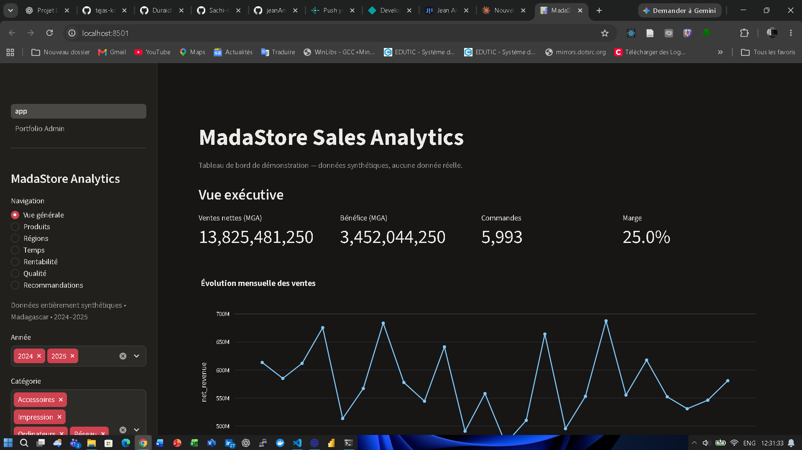

### 2. Vue générale — ventes par catégorie et par région

Ces graphiques comparent la contribution des grandes familles de produits et des régions. Ils permettent de repérer rapidement où se concentrent les ventes du jeu synthétique.

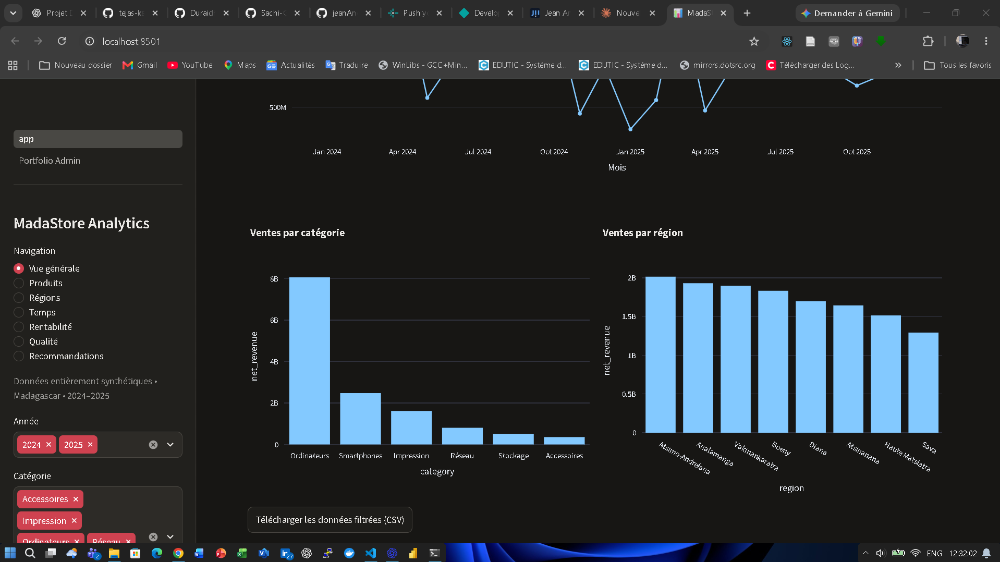

### 3. Produits — classement des ventes

Le classement montre quels articles cumulent le plus de ventes. Le produit le plus vendu n’est pas forcément celui qui génère le plus de bénéfice.

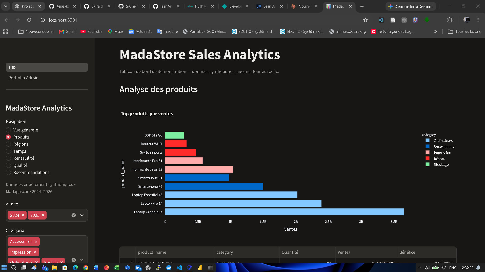

### 4. Produits — ventes et bénéfices détaillés

Le tableau donne, pour chaque produit, les quantités vendues, les ventes et le bénéfice estimé. Il aide à distinguer les produits populaires des produits les plus rentables.

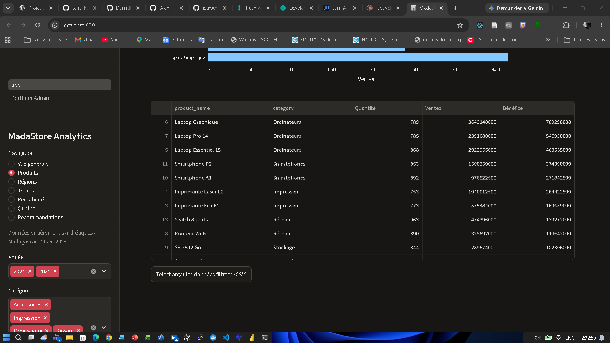

### 5. Régions — comparaison géographique

Le graphique compare les ventes entre les régions de Madagascar présentes dans le jeu de démonstration.

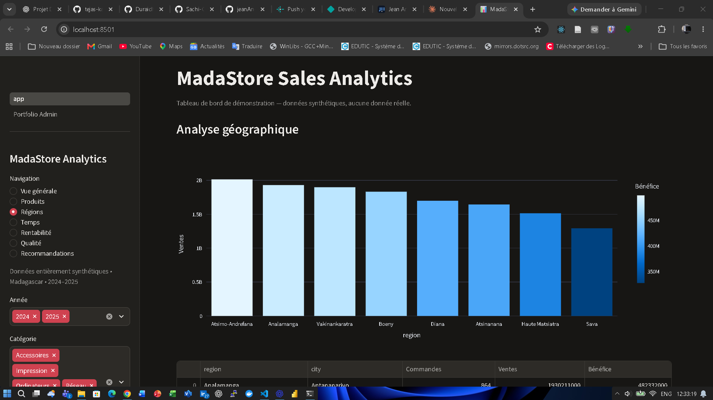

### 6. Régions — détails par ville

Le tableau complète le graphique avec le nombre de commandes, les ventes et le bénéfice par région et par ville.

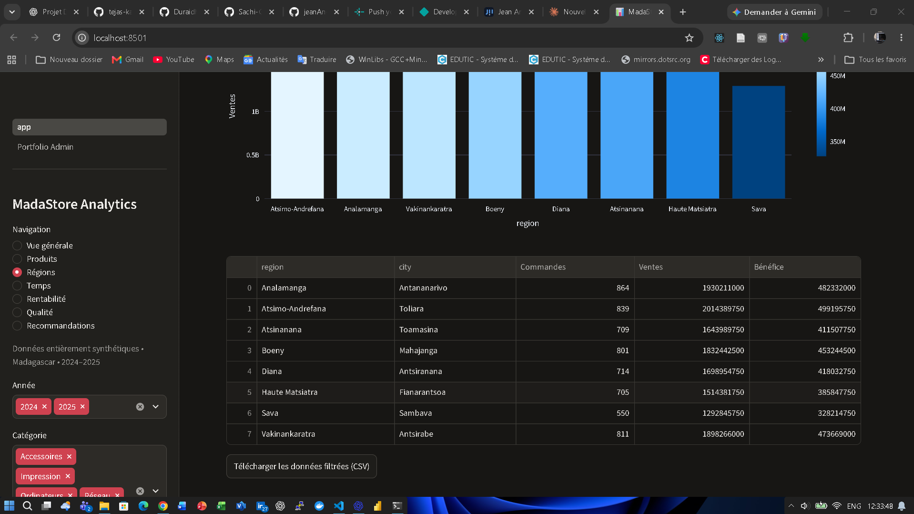

### 7. Temps — évolution mensuelle

Cette vue suit les ventes et le bénéfice mois après mois. Elle sert à observer des variations dans les données simulées, sans conclure qu’elles se reproduiraient dans la réalité.

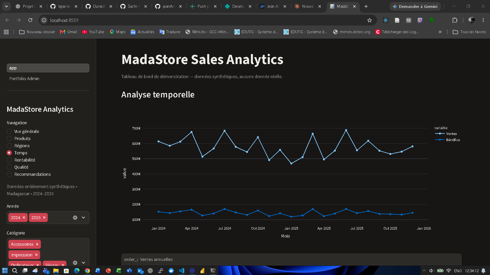

### 8. Temps — comparaison annuelle

Le tableau présente les ventes nettes agrégées par année pour comparer les deux périodes simulées.

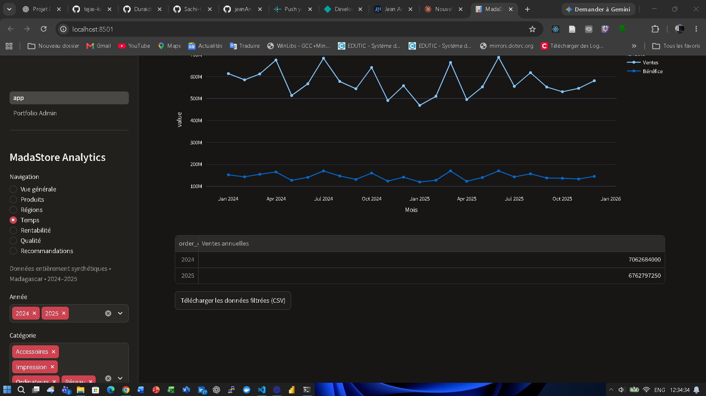

### 9. Rentabilité — bénéfices et marges

Cette vue met côte à côte le bénéfice et la marge par catégorie. Le bénéfice indique le montant gagné ; la marge indique la part des ventes conservée après le coût des produits.

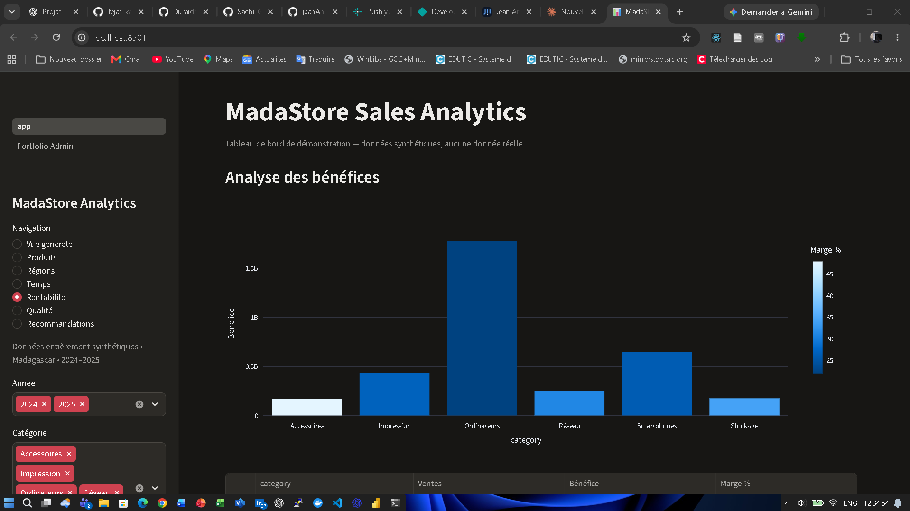

### 10. Rentabilité — chiffres par catégorie

Le tableau fournit les valeurs exactes utilisées pour comparer ventes, bénéfices et marges.

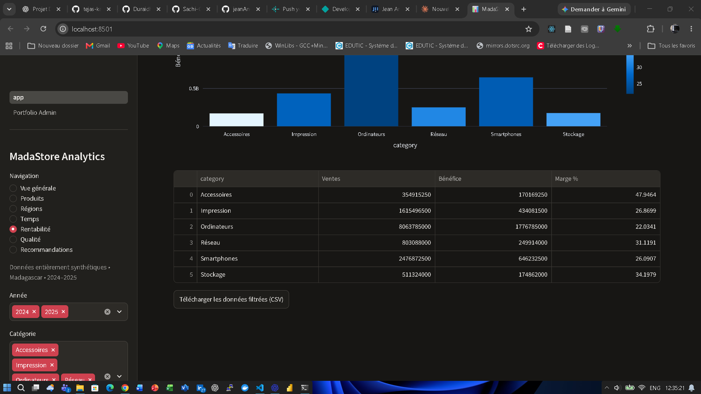

### 11. Qualité des données

Avant l’analyse, les données sont contrôlées. Cette vue indique notamment combien de lignes restent après nettoyage et si des valeurs manquantes ou des commandes en double subsistent.

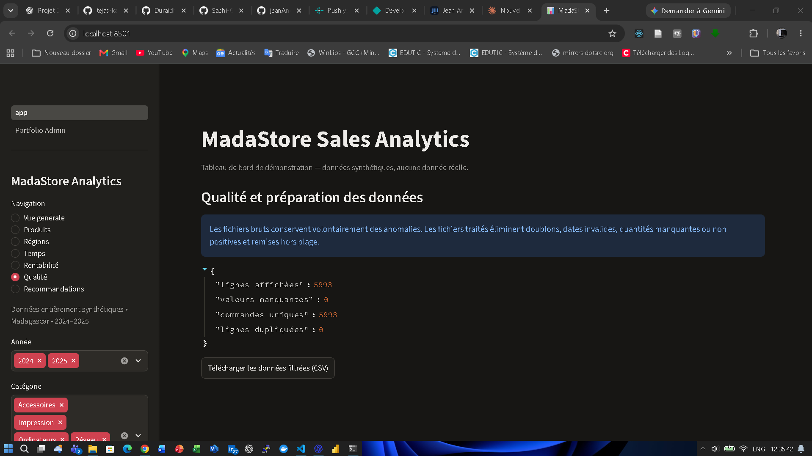

### 12. Recommandations

Le tableau de bord formule des pistes de réflexion à partir des filtres et des chiffres affichés. Elles sont exploratoires et reposent uniquement sur les données fictives.

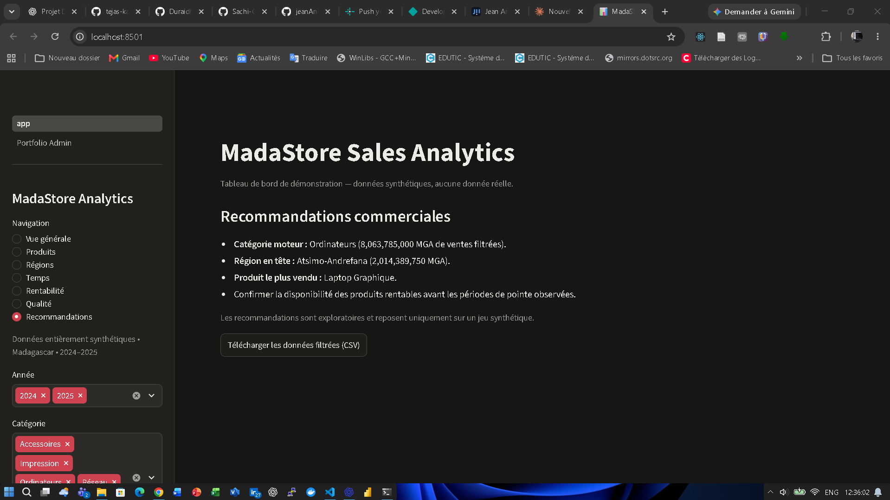

## Quelques mots expliqués simplement

- **Ventes nettes** : total des ventes après les remises.
- **Coût des produits** : coût estimé des articles vendus.
- **Bénéfice** : ventes nettes moins coût des produits.
- **Marge** : pourcentage des ventes nettes qui reste après ce coût.
- **Nettoyage** : vérifications et corrections qui rendent les données plus cohérentes avant les calculs.
- **Données synthétiques** : données fabriquées pour démontrer une méthode, sans représenter de transactions réelles.

## Comment le projet a été réalisé

1. Création reproductible de 6 000 ventes fictives pour 2024 et 2025.
2. Ajout et documentation de défauts de test dans les fichiers bruts : doublons, champs manquants et valeurs invalides.
3. Contrôle et nettoyage des données. Les fichiers de départ sont conservés ; 5 993 commandes valides sont utilisées pour les analyses.
4. Calcul et vérification croisée des indicateurs avec Python et SQLite.
5. Préparation d’un classeur Excel et d’un tableau de bord Streamlit interactif.

Le projet comprend également 15 analyses SQL avec des jointures et des regroupements. Les résultats financiers sont recalculés de manière cohérente dans les différents livrables.

## Lancer le tableau de bord sur Windows

Ouvrez PowerShell dans le dossier du projet et exécutez :

```powershell
python -m venv .venv
.venv\Scripts\Activate.ps1
python -m pip install -r requirements.txt
streamlit run dashboard/app.py
```

Ouvrez ensuite `http://localhost:8501` dans votre navigateur. Le dépôt contient déjà les données nettoyées nécessaires au tableau de bord.

Pour régénérer et retraiter les données, les scripts sont dans `src/`. Les consignes détaillées pour GitHub et le parcours débutant sont dans `docs/github_guide_fr.md` et `docs/guide_debutant.md`.

## Contenu du dépôt

| Dossier | Ce qu’il contient |
| --- | --- |
| `dashboard/` | Le tableau de bord interactif |
| `data/raw/` | Les fichiers de départ et leurs défauts de démonstration |
| `data/processed/` | Les fichiers contrôlés et prêts pour l’analyse |
| `src/` | Les scripts Python de création, nettoyage et analyse |
| `sql/` | Les requêtes de comparaison et d’analyse |
| `reports/` | Le classeur Excel, les graphiques et les recommandations |
| `screenshots/readme/` | Les captures d’écran intégrées à ce README |
| `powerbi/` | Le modèle, les mesures DAX et les consignes Power BI |
| `tests/` | Les vérifications automatisées du projet |

## État de Power BI

Power BI Desktop est installé et les données nettoyées ont été importées. La mise en page du rapport et l’enregistrement du fichier `.pbix` restent à terminer. Le projet ne présente donc pas de rapport Power BI finalisé.

## Limites et licence

MadaStore et toutes ses transactions sont fictifs. Les chiffres servent à illustrer une démarche d’analyse et ne permettent pas de conclure sur de vrais clients, marchés ou performances. Le projet est distribué sous licence MIT ; voir [`LICENSE`](LICENSE).
